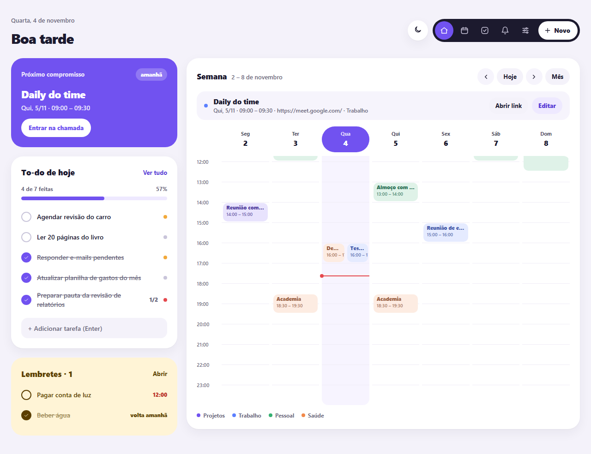
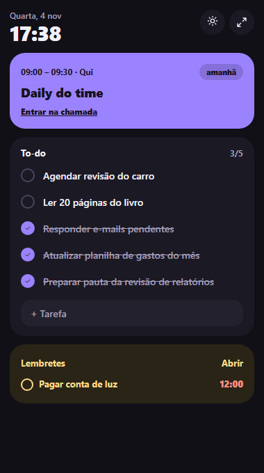

# Daily Life

App de produtividade para Windows. Abre junto com o PC e junta **to-do, lembretes, compromissos e calendário** numa janela só, com modo widget, tema claro e escuro, avisos do Windows, Google Agenda e acesso pelo celular.

Feito com Python: Flask (telas e API) + pywebview (janela) + SQLite (dados no seu PC).

<p>
  
  
</p>

---

## 1. Instalar

1. Baixe **[DailyLife-Setup.exe](https://github.com/ana-psg/daily-life-app/releases/latest/download/DailyLife-Setup.exe)** (só esse arquivo, sempre a versão mais nova) e abra. Não precisa de administrador nem de Python. As versões anteriores ficam em [Releases](https://github.com/ana-psg/daily-life-app/releases).
2. O Windows pode avisar "editor desconhecido" (o programa não tem assinatura digital paga): clique em **Mais informações > Executar assim mesmo**. Veja a seção 9.
3. Escolha se quer atalho na Área de Trabalho e **Abrir ao iniciar o Windows**.

Cada pessoa começa com o app vazio. Instalar uma versão nova por cima **não apaga seus dados**, e desinstalar também não: eles ficam em `%APPDATA%\Daily Life`.

> O WebView2 (motor da janela) já vem no Windows 10 e 11. Se a janela abrir em branco, instale o "Microsoft Edge WebView2 Runtime".

## 2. Usar

| Onde | O que faz |
| --- | --- |
| Painel | Próximo compromisso, to-do de hoje com progresso, lembretes e a semana. Dois cliques num horário vazio criam um compromisso. |
| Widget | Versão compacta, sem bordas. Arraste pelo topo (onde fica a hora). |
| Calendário | Visões Dia, Semana e Mês; mostrar ou esconder calendários. |
| To-do | Abas Hoje, Semana, Projetos, Feitas; subtarefas; arrastar para reordenar. |
| Lembretes | Cartões com repetição, adiar 1 h e marcar como feito. |
| Configurações | Tema, inicialização, avisos, Google, celular, backup. |

**Compromissos que se repetem:** ao abrir um deles, escolha **Só este** (muda ou exclui só aquele dia) ou **Todos** (muda a série inteira). Compromissos de calendários do Google só de leitura (como feriados) abrem só para ver.

**Campo rápido de tarefa:** `Ligar pro banco amanhã !alta #semana` cria a tarefa com vencimento amanhã, prioridade alta, na lista Semana.

**Lembretes recorrentes:** ao marcar, contam como concluídos hoje e voltam na próxima vez (normalmente no dia seguinte). "A cada 2 h" avisa de 2 em 2 horas até você marcar. Semanais e mensais que passaram sem marcar ficam como atrasados até você marcar. No horário de "não perturbe", os lembretes esperam e avisam quando ele acabar.

**Atalhos de teclado:** `N` tarefa · `C` compromisso · `L` lembrete · `W` painel/widget · `T` tema · `1` a `4` trocam de tela · `Esc` fecha.

**Fechar a janela não fecha o app:** ele fica no ícone da bandeja (perto do relógio) para os avisos funcionarem. Para sair de verdade: clique com o botão direito no ícone > **Sair do Daily Life**.

## 3. Abrir junto com o Windows

Em **Configurações > Ao ligar o PC**, ligue **Abrir junto com o Windows** e escolha se abre como painel ou widget. Ligue **Widget sempre por cima** para ele ficar como nota adesiva.

Isso cria uma entrada em `HKEY_CURRENT_USER\...\Run` (não precisa de administrador). O instalador oferece a mesma opção, e desinstalar remove essa entrada.

## 4. Google Agenda

O Daily Life não traz nenhuma credencial pronta: cada pessoa conecta com um projeto próprio, gratuito, na própria conta Google. Todos os calendários da sua conta entram no app (dá para esconder cada um). O que você cria num calendário do Google aparece no celular; calendários locais (Trabalho, Pessoal, Saúde, Projetos) ficam só no PC.

**Passo a passo (uma vez, uns 10 minutos):**

1. Entre em [console.cloud.google.com](https://console.cloud.google.com) com sua conta e crie um projeto (ex.: "Daily Life").
2. Ative a **Google Calendar API**: menu > APIs e serviços > Biblioteca > "Google Calendar API" > Ativar.
3. Menu > **Google Auth Platform > Branding** > Get started. Nome do app: Daily Life; e-mail de suporte: o seu. Em **Audience**, escolha **External**. Termine o assistente.
4. Em **Google Auth Platform > Audience > Test users**, adicione o seu próprio e-mail.
5. Em **Google Auth Platform > Clients > Create client**, tipo **Desktop app**, nome "Daily Life". Baixe o JSON.
6. Renomeie o arquivo para **`credentials.json`** e coloque em `%APPDATA%\Daily Life` (a tela de Configurações mostra a pasta exata).
7. No app: **Configurações > Google Agenda > Conectar**. O navegador abre; entre na conta e autorize. Pode aparecer "O Google não verificou este app": clique em Avançado > Acessar Daily Life (o app é seu).

**Importante:** com o app em modo "Testing", o Google pode pedir login de novo depois de alguns dias. Se aparecer o aviso "O acesso ao Google expirou", é só clicar em Conectar de novo. Para evitar, em **Audience** clique em **Publish app** (para uso pessoal não precisa de verificação; só aparece o aviso do passo 7).

Como a sincronização funciona: envia o que mudou no app, baixa o que mudou no Google (a cada 5 min, ou no intervalo escolhido) e, em conflito, vale a alteração mais recente. Sem internet, as mudanças ficam guardadas e vão quando a conexão voltar.

## 5. Usar no celular (4G ou Wi-Fi, pelo Tailscale)

O [Tailscale](https://tailscale.com) cria uma rede privada só entre os seus aparelhos. O celular abre o app do PC de qualquer lugar, com HTTPS, e os dados continuam só no PC. O plano Personal é grátis para uso pessoal. O PC precisa estar ligado (o Google Agenda continua no celular mesmo com o PC desligado).

**Uma vez só (uns 10 minutos):**

1. Instale o Tailscale no PC ([tailscale.com/download](https://tailscale.com/download)) e no celular (Play Store), e entre com a **mesma conta** nos dois.
2. No PC: **Configurações > Usar no celular**: crie uma **senha** (mínimo 6 caracteres) e toque em **Ligar**.
3. Na primeira vez, o Tailscale pede para liberar o HTTPS na sua conta: o app mostra o link. Abra, confirme e toque em **Ligar** de novo. (Isso publica o nome do PC, como `notebook.tail1234.ts.net`, num registro público de certificados; o acesso continua só para os seus aparelhos.)
4. Aparece um **QR code**. No celular, com o Tailscale ligado, leia o QR com a câmera, abra no Chrome e entre com a senha.
5. No menu do Chrome, toque em **Instalar app**: vira um ícone na tela inicial.
6. No celular, em **Configurações > Avisos neste celular**, toque em **Receber avisos** e permita as notificações. Use **Testar** para conferir.

Os avisos chegam com os botões **Resolvido** e **Adiar 1 h**, iguais aos do Windows, nos mesmos horários (respeitam o "não perturbe"). Trocar a senha desconecta os aparelhos; para parar tudo, toque em **Desligar acesso** no PC.

## 6. Dados e backup

- Tudo fica em `%APPDATA%\Daily Life`: banco `dailylife.db` e backup automático diário em `backups` (ficam os últimos 14). Rodando pelo código, a pasta é `data/` do projeto.
- **Exportar/Importar** em Configurações gera ou lê um JSON com tudo (a senha não vai junto).
- Logs em `dailylife.log`, na mesma pasta (útil se algo der errado).
- Banco, token, chaves e `credentials.json` nunca vão para o Git nem para o instalador; o build confere isso e para se encontrar algum.

## 7. Gerar o instalador

Precisa do [Inno Setup 6](https://jrsoftware.org/isinfo.php) (`winget install JRSoftware.InnoSetup`) e das dependências de desenvolvimento.

```
python -m venv .venv
.venv\Scripts\pip install -r requirements-dev.txt
.\build.ps1
```

O script limpa, roda os testes, gera o executável em pasta (sem UPX), confere que nenhum dado pessoal entrou e cria `dist\DailyLife-Setup-<versão>.exe`. Para mudar a versão, altere `pyproject.toml`, `packaging/version_info.txt` e `packaging/DailyLife.iss` (um teste confere que estão iguais).

**Levar dados do `data/` para o programa instalado:** feche o app (bandeja > Sair) e rode `python tools/migrar_dados.py`. Ele só copia: não apaga a origem e não sobrescreve um banco que já exista.

## 8. Para desenvolver

```
.venv\Scripts\activate
python main.py --debug              # app com DevTools
python -m dailylife.web.app         # só no navegador: http://127.0.0.1:5055
pip install -r requirements-dev.txt  # ferramentas de desenvolvimento (uma vez)
python -m pytest
python tests/e2e_telas.py           # robô que clica em todas as telas (precisa do Playwright)
python tools/seed.py --forcar       # recria os dados de exemplo
ruff check . && ruff format .       # padrão do Python
npx prettier --write "dailylife/static/**/*.{js,css}"   # padrão do JavaScript e do CSS
python tools/diagnostico.py         # o que carregou e o que o Windows bloqueou
```

Regras do projeto em `CLAUDE.md`. Estrutura:

```
main.py                 abre o app (é o que o .exe roda)
dailylife/
  config.py             nome, pastas, porta e hora de São Paulo
  db.py                 SQLite: schema atual + migrações numeradas (PRAGMA user_version)
  core/                 regras: todos, reminders, events, calendars, settings, dashboard,
                        recurrence, backup
  web/                  app.py (monta o servidor), security.py (quem pode pedir o quê),
                        pages.py (telas e senha), api.py (API JSON), net.py
  desktop/              app.py (abre tudo), windows.py (painel, widget e plano B no Edge), tray.py (bandeja),
                        scheduler.py (avisos, Google, backup a cada 30 s), notifier.py, startup.py
  sync/                 google.py (login e rodada completa), pull.py (baixa), push.py (envia),
                        convert.py (formatos), common.py
  tailscale.py          acesso pelo celular (tailscale serve) · qr.py: QR code em SVG
  push.py               avisos no celular (Web Push)
  templates/            HTML (Jinja); _icons.html tem todos os ícones
  static/               css (tokens.css = cores; base, painel, telas, janelas, responsivo, nesta ordem),
                        js (um por tela; modal_*.js = janelas de edição), img
tests/                  testes (pytest) e o robô das telas
tools/                  seed.py, diagnostico.py, make_icons.py, migrar_dados.py, verificar_pacote.py
packaging/              receita do executável e script do instalador (Inno Setup)
build.ps1               gera o instalador
```

## 9. Avisos do Windows ao instalar

O Daily Life não tem assinatura digital, que é paga. Por isso:

- **SmartScreen ("editor desconhecido"):** aparece ao abrir o instalador baixado. Clique em **Mais informações > Executar assim mesmo**.
- **Controle de Aplicativos Inteligente:** se estiver ligado no seu Windows, **bloqueia o programa sem dar opção de abrir assim mesmo**. Para instalar, é preciso desligar o recurso em **Segurança do Windows > Controle de aplicativos e do navegador > Configurações do Controle de Aplicativos Inteligente**.

Rodando pelo código, se a janela própria for bloqueada, o app abre no Edge em modo aplicativo; se os avisos com botões forem bloqueados, saem como balão da bandeja. Para ver o que foi bloqueado, rode `python tools/diagnostico.py`.

## 10. Problemas comuns

| Problema | Solução |
| --- | --- |
| Nada acontece ao abrir | Veja a seção 9 e o `dailylife.log` em `%APPDATA%\Daily Life`. |
| Abriu no Edge em vez da janela própria | A janela foi bloqueada pelo Windows. Veja a seção 9. |
| "A porta 5055 está em uso" | Outro programa usa a porta. Defina a variável `DAILYLIFE_PORT` com outro número. |
| Avisos não aparecem | Configurações do Windows > Notificações: deixe as notificações ligadas. Confira o "Não perturbe" do app. |
| Celular não abre | O Tailscale está ligado no celular e no PC? O acesso aparece como ligado nas Configurações do PC? O PC está ligado e com o app aberto? |
| Avisos não chegam no celular | Toque em Testar. Confira se as notificações do Chrome estão permitidas e se a economia de bateria não bloqueia o Chrome. |
| Google pede login de novo | Normal no modo "Testing". Veja a seção 4. |
